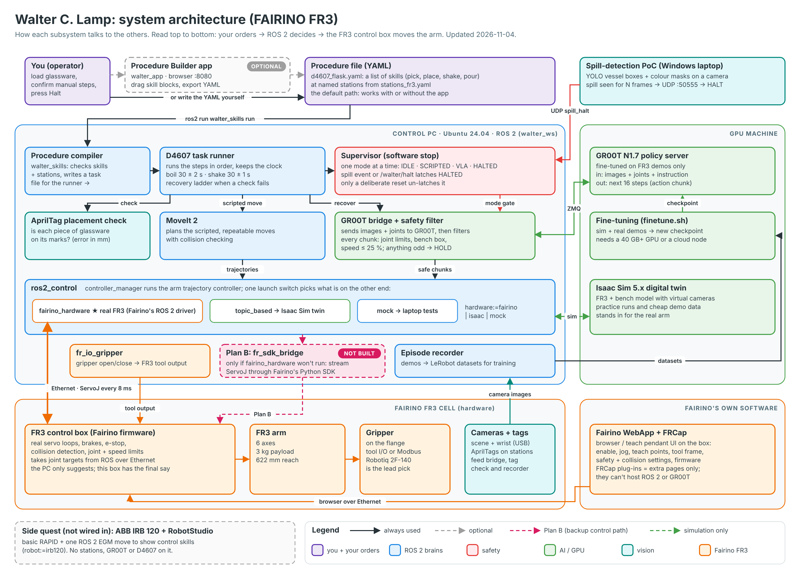

# Walter C. Lamp system architecture (FAIRINO FR3)

Updated 2026-11-04. Replaces the IRB 120 version from 2026-10-20, which is kept as
[ARCHITECTURE_irb120_2026-10-20.md](ARCHITECTURE_irb120_2026-10-20.md).

Diagram files: [architecture_fr3.svg](architecture_fr3.svg) (zoomable),
[architecture_fr3.png](architecture_fr3.png), and the source that draws both,
[diagram/make_architecture_diagram.py](diagram/make_architecture_diagram.py).

## The short version

Walter has three layers, and each one only talks to the layer next to it:

1. **Your orders.** A procedure file (YAML) lists skills like "pick flask at rack, place on hot
   plate, wait 30 s". You can write it by hand or build it in the optional Procedure Builder app.
2. **The brains (ROS 2 on the control PC).** ROS 2 turns the procedure into motion. Scripted,
   timed steps go through MoveIt. When something goes wrong (a funnel is off its marks), the
   GR00T AI tries a recovery, and a safety filter checks every move it suggests.
3. **The muscles (the FR3 control box).** FAIRINO's firmware runs the motors, brakes, e-stop and
   collision detection. ROS 2 streams joint targets to it through FAIRINO's own ROS 2 driver.
   The box can always say no.

The one rule that holds it together: **the PC suggests, the control box decides.** GR00T can be
as confident as it likes; the FR3's own limits and e-stop sit underneath everything.

## Which software is FAIRINO's and which is ours

| Piece | Made by | Runs on | What it does for Walter |
|---|---|---|---|
| FR3 firmware | FAIRINO | FR3 control box | Servo loops, brakes, e-stop chain, collision detection, joint and speed limits. Needs V3.7.5 or newer for the ROS 2 driver. |
| WebApp | FAIRINO | Served by the control box, opened in a browser or on the teach pendant | Enable the arm, jog it, teach points, set the tool frame, safety planes, collision sensitivity, speed limits, and update firmware. This is where the hardware-level limits live. |
| FRCap | FAIRINO | Inside the WebApp (Node.js + Vue plug-ins) | Adds extra pages to the WebApp. Handy for a status screen later, but it **cannot host ROS 2 or GR00T**, so Walter doesn't depend on it. |
| frcobot_ros2 (`fairino_hardware`, `fairino_msgs`, `fairino_description`) | FAIRINO (github.com/FAIR-INNOVATION/frcobot_ros2) | Control PC | Their version of ROS 2 support: a ros2_control plugin that streams joint targets to the box (ServoJ every 8 ms) and reads joint states back. We use their hardware plugin and meshes. Their MoveIt configs are ignored because `walter_moveit_config` replaces them. |
| FAIRINO Python SDK (`from fairino import Robot`) | FAIRINO | Control PC | Used by `fr_io_gripper` to flip the tool output that opens and closes the gripper. Also the Plan B motion path (below). |
| walter_ws (7 packages) | Us | Control PC | Everything else in the blue box: procedures, task runner, supervisor, MoveIt config, GR00T bridge, safety filter, recorder, app. |
| GR00T N1.7 + fine-tune scripts | NVIDIA model, our config (`controls/vla/`) | GPU machine | The AI that recovers from mistakes. |
| Isaac Sim 5.x scene | NVIDIA sim, our script (`controls/sim/isaac/`) | GPU machine | Digital twin for practice runs and training data. |
| Spill-detection PoC | Us (`Computer Vision Proof of Concept/`) | Windows laptop | Watches for spills and halts the arm. |

So "using FAIRINO's software" means: the WebApp sets the hardware rules, the firmware enforces
them, and FAIRINO's ROS 2 driver is the doorway between our ROS 2 stack and the box. Our code
never talks to the motors directly.

## Each subsystem in one paragraph

**Procedure file and compiler (`walter_skills`).** A procedure is a list of registered skills at
named stations. Station poses for the FR3 live in `stations_fr3.yaml`. The compiler rejects
anything the arm can't do (an unknown skill, a missing station, picking with a full gripper) and
writes a task file for the runner. Command: `ros2 run walter_skills run d4607_flask.yaml`.

**Procedure Builder app (`walter_app`, optional).** A drag-and-drop page at
http://localhost:8080 that produces the exact same YAML and sends it through the exact same
compiler, so the app can't ask for anything the command line couldn't. The standalone practice
build is in `procedure_builder_skeleton/`. Skip the app and Walter works exactly the same: it's a
nicer front door for people who'd rather not touch YAML, not a requirement.

**D4607 task runner.** Runs the steps in order and owns the clock: boil 30 ± 2 s, shake
30 ± 1 s, no delay before filtering. Before a step that needs equipment in a fixed spot it asks
the placement checker. If the check fails it climbs the recovery ladder: GR00T recovery (only for
light items while the gripper is empty), then the operator, then stop. Every run logs to
`~/.ros/walter_runs/<stamp>/events.jsonl`.

**AprilTag placement checker.** Tags on each station tell it whether the rack, hot plate, funnel
and so on are on their marks, with the error in millimetres. This is what makes the scripted
moves repeatable, since a scripted move assumes nothing has moved.

**MoveIt 2.** Plans the scripted moves with collision checking against the bench and stations.

**Supervisor.** Owns the mode: IDLE, SCRIPTED (task runner/MoveIt move the arm), VLA (GR00T moves
it), or HALTED. A spill event, a `true` on `/walter/halt`, or the app's Halt button latches
HALTED, and only a deliberate reset leaves it. It's a software stop, not a replacement for the
wired e-stop.

**GR00T bridge and safety filter.** In VLA mode the bridge sends the two camera images, the six
joint angles, the gripper state and a sentence ("put the funnel back on its stand") to the GR00T
server, and gets back the next 16 steps. Every chunk passes the safety filter: joint limits minus
a margin, a TCP box over the bench (the FR3 is mounted yawed 180°, so that box sits at negative x
in the robot's frame), joint speed capped at 25 % of the FR3's rated 180°/s, and no big jump from
the current pose. Anything odd becomes a HOLD. No reply from GR00T for over 1 s is also a HOLD.

**ros2_control.** The layer that actually commands joints. One launch switch picks what is on
the other end, and nothing above it knows or cares which:

| `hardware:=` | Plugin | Use |
|---|---|---|
| `fairino` | `fairino_hardware` (FAIRINO's ROS 2 driver) | The real FR3 at 192.168.58.2 |
| `isaac` | `topic_based_ros2_control` | Isaac Sim twin |
| `mock` | `mock_components/GenericSystem` | Laptop tests and CI |

Launch for the real arm:
`ros2 launch walter_bringup bringup.launch.py robot:=fr3 hardware:=fairino controller_ip:=192.168.58.2`

**fr_io_gripper.** The gripper isn't a ros2_control joint on the real FR3. This node listens to
the normal gripper command topic and sets the FR3's tool digital output through the Python SDK.
A smarter gripper (the Robotiq 2F-140 is the lead pick) would use the FR3's Modbus gripper
commands instead.

**Episode recorder, fine-tuning and the GR00T server.** Demos from Isaac and from real teleop are
recorded as LeRobot datasets, fine-tuned on the GPU machine (`vla/finetune.sh`), and served with
`vla/serve.sh` on ZMQ port 5555. GR00T must be trained on FR3 data only (`robot_type:=fairino_fr3`);
IRB 120 demos would teach it the wrong body.

**Spill-detection PoC.** Runs on the Windows laptop, finds vessels with YOLO and liquid/solid
with colour masks, and sends `spill_halt` over UDP 50555 to the supervisor via
`integrations/spill_udp.py`. Fire-and-forget: if the PoC crashes, the arm keeps its other
safety layers.

## One D4607 run, following the arrows

1. You set up the glassware and start `d4607_flask.yaml` (from the terminal or the app).
2. The compiler checks it against `stations_fr3.yaml` and hands a task file to the task runner.
3. The task runner asks the placement checker whether the rack and hot plate are on their marks.
   Yes: it asks MoveIt for "flask from rack to hot plate", and MoveIt's trajectory goes through
   ros2_control and `fairino_hardware` to the control box, which moves the arm.
4. The boil timer runs (30 ± 2 s). The runner logs the actual time and whether it met tolerance.
5. Before the pour, the checker says the funnel is 18 mm off. The runner switches the supervisor
   to VLA and asks GR00T to "put the funnel back on its stand". The bridge streams images to
   GR00T, filters each chunk, and sends the safe ones down the same ros2_control path.
6. The checker passes, the supervisor goes back to SCRIPTED, and the pour runs as a scripted move.
7. If the spill camera sees liquid outside a vessel at any point, the supervisor latches HALTED
   and the arm holds where it is until you reset.

## Safety layers (outermost wins)

1. Wired e-stop and a guarded workspace. Hardware, not software.
2. FR3 firmware: joint and TCP speed limits, safety planes and collision sensitivity, all set in
   the **WebApp**. Set these before ROS 2 ever connects.
3. Supervisor HALTED latch (fed by the spill camera, `/walter/halt` and the app's Halt button).
4. Safety filter on every GR00T chunk.
5. MoveIt collision checking on scripted moves.

Layers 3 to 5 are ours and are development aids. Layers 1 and 2 are the ones that keep the
glassware intact when the code has a bad day. First trials: water only, reduced speed in the
WebApp, guarded cell.

## Can FAIRINO's software run GR00T? (and Plan B)

FRCap can't, and it doesn't need to. GR00T never talks to FAIRINO's software directly: it talks
to our bridge, the bridge talks to ros2_control, and ros2_control talks to the box through
`fairino_hardware`. That's the main path (solid orange in the diagram).

The real risk is the driver. FAIRINO develops and tests `frcobot_ros2` on ROS 2 Humble, it hasn't
been built in our Jazzy workspace yet, and its IP is hard-coded. If it won't build or can't keep
up, we're not cooked. Two fallbacks, in this order:

1. **Move the whole workspace to Humble.** Our nodes are plain `rclpy` and should port with
   little change. It has to be the whole workspace: a ros2_control plugin loads inside the
   controller manager, and mixing Humble and Jazzy nodes over the network isn't officially
   supported. Humble is supported until May 2027.
2. **Plan B: `fr_sdk_bridge` (not built yet, dashed pink in the diagram).** A small node that
   takes the controller's joint targets and streams them to the box with the FAIRINO Python SDK's
   ServoJ, skipping `fairino_hardware`. Everything above ros2_control, GR00T included, stays the
   same.

If neither works, the stack also runs on any arm with a ros2_control driver that follows position
targets at 100 Hz or more. Only `walter_description` and the limit files change.

## Machines and network

| Machine | Runs | Address / port |
|---|---|---|
| FR3 control box | Firmware, WebApp, FRCap | 192.168.58.2 (FAIRINO default, used by `fairino_hardware`) |
| Control PC (Ubuntu 24.04) | walter_ws, MoveIt, RViz, app | App on :8080 (localhost unless the network is the cell's own) |
| GPU machine | GR00T server, fine-tuning, Isaac Sim | GR00T on ZMQ :5555 |
| Windows laptop | Spill PoC | Sends to the control PC on UDP :50555 |

Use a wired, dedicated link from the control PC to the FR3 box. ServoJ every 8 ms over Wi-Fi is a
recipe for jerky motion. Cameras can share a switch with the GPU machine but not with the arm link.

## Side quest: ABB IRB 120 + RobotStudio

Still in the workspace (`robot:=irb120`, `hardware:=abb`) for one job: showing basic control
skills with a RAPID program and one ROS 2 EGM move. It has no stations, no GR00T and no D4607
sequence, and it isn't connected to anything else in the diagram.

## Known gaps

- `fairino_hardware` hasn't been built on Jazzy or run against a real FR3 or the FR3 SimMachine.
  Everything FR3-related has only run on mock hardware.
- `fr_io_gripper` opens a second SDK connection next to `fairino_hardware`'s. FAIRINO users report
  trouble with two clients at once, so test it on the bench first.
- Plan B (`fr_sdk_bridge`) is a design, not code.
- `stations_fr3.yaml` poses are placeholders. Teach real ones with the `teach` tool.
- The Isaac Sim script hasn't been run, and there's no fine-tuned GR00T checkpoint yet.
- The gripper is still a placeholder in the URDF. No candidate gripper has real force sensing;
  true newtons would need a wrist F/T sensor.
